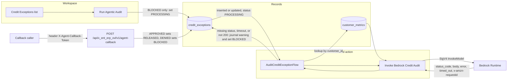
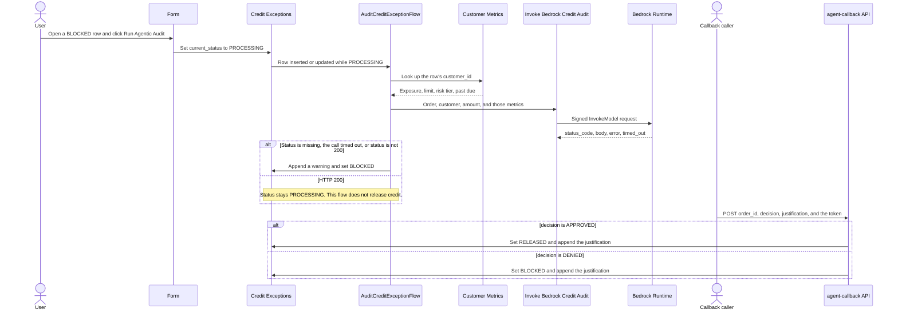

# Agentic ERP Overlay

ServiceNow Fluent application for an order-to-cash overlay. Scope `x_ent_erp_ovl` (the hyphenated form `x-ent-erp-ovl` is not a valid scope). The application source is the repository root.

One app holds five stages: credit, order, fulfillment, invoice, and cash. A person queues the audit. The stage flow looks up customer metrics and calls the model runtime with a signed request. The model only advises. None of the flows set `RELEASED`. Release happens only when a caller posts an approved decision to the callback API.

## Architecture





`Run Agentic Audit` is a record button. It is available while `current_status` is `BLOCKED`, and it sets that field to `PROCESSING`, which starts `AuditCreditExceptionFlow`.

The same path is used for order holds, fulfillment holds, invoice holds, and cash applications. Each stage has its own table, form button, and flow. The button is available while `current_status` is `BLOCKED`. It writes a correlation id, inserts a `BUTTON` audit event, and sets `PROCESSING`. The flow passes that correlation id and the process name (`credit`, `order`, `fulfillment`, `invoice`, or `cash`) into the same Bedrock action. The prompt says which stage is being reviewed. The flow never sets `RELEASED`.

The flow looks up `customer_metrics` by `customer_id`, then calls the Integration Hub script step. That step reads the endpoint, access key, secret key, region, and model id from password and string system properties, signs the request with SigV4, and returns `status_code`, `body`, `error`, `timed_out`, `correlation_id`, and `aws_request_id`. `aws_request_id` is the `x-amzn-requestid` response header. The script does not log the access key, the secret, or the Authorization header. If the status is missing, the call timed out, or the status is not 200, the flow appends a warning to `ai_justification` and sets `current_status` back to `BLOCKED`. Either way, the flow inserts a `BEDROCK_RESULT` audit event.

`POST /api/x_ent_erp_ovl/v1/agent-callback` requires header `X-Agent-Callback-Token`, compared in constant time with property `x_ent_erp_ovl.callback_token`. The body is `order_id`, `decision` (`APPROVED` or `DENIED`), `justification`, and optional `process`. `order-id` is accepted when `order_id` is absent. A missing `process` means `credit`. `process` may be `credit`, `order`, `fulfillment`, `invoice`, or `cash`. `APPROVED` sets `RELEASED`. `DENIED` sets `BLOCKED`. The justification is appended to `ai_justification`. A successful update inserts a `CALLBACK` audit event.

## Audit trail

Two trails are recorded on purpose.

Field history. Every stage table, `customer_metrics`, and `x_ent_erp_ovl_audit_events` are created with `audit: true`. ServiceNow then writes `sys_audit` when a field such as status or the journal changes. Open the record and use the form History list to see who changed a field.

Event trail. `x_ent_erp_ovl_audit_events` is append-only. Each row records the process, order id, source table, source record, event (`BUTTON`, `BEDROCK_RESULT`, or `CALLBACK`), correlation id, AWS request id, HTTP status, decision, and a short note. The button, each stage flow, and the callback insert a row. The table does not store the AWS secret or the full model prompt. The workspace lists this table next to the stage tables.

The correlation id is written on the stage row when the person clicks the button, passed into Bedrock, and copied onto each audit event for that run. The AWS request id on the `BEDROCK_RESULT` row is the join key to Bedrock’s own logs. The callback copies that request id onto the `CALLBACK` row when it finds a matching correlation id.

## Bedrock invocation logging

This app cannot turn on AWS logging. Model invocation logging is an account setting in Amazon Bedrock.

1. In the Bedrock console, open Settings and turn on model invocation logging.
2. Send the logs to CloudWatch Logs, S3, or both.
3. Include request metadata and response metadata. Leave text and image data off if you do not want the prompt stored in AWS.
4. Do not copy the AWS secret into a ServiceNow log, journal, or audit note. The password properties stay on the instance, and the script does not write them out.
5. Find the call with the `aws_request_id` stored on the audit event. That value is the `x-amzn-requestid` header. Search CloudWatch Logs or the S3 log objects for the same id. CloudTrail records the API call as well when data events are enabled for Bedrock.

The ServiceNow event row and the Bedrock log then show the same request.

## Layout

```text
now.config.json                 scope, name, and SDK paths
package.json
src/app.fluent.ts               tables, role, and system properties
src/server/api-routes.ts        callback REST API
src/server/spoke-actions.ts     signed InvokeModel action
src/server/workflow-flows.ts    one audit flow per stage
src/ui/workspace-components.ts  workspace lists and one queue button per stage
```

The compiler reads `*.now.ts`. `npm run build` and `npm run typecheck` copy these sources to sibling `*.now.ts` files first. The copies are gitignored.

## Build

From the repository root, with Node.js 20 or newer:

```bash
npm install
npm run typecheck
npm run build
```

`npm run typecheck` and `npm run build` run offline and write platform metadata under `dist/app`. `npm run deploy` (`now-sdk install`), `now-sdk transform` without `--from`, `now-sdk dependencies`, and `now-sdk auth` need a ServiceNow instance. Replace `scopeId` in `now.config.json` if scope `x_ent_erp_ovl` already exists on that instance.
