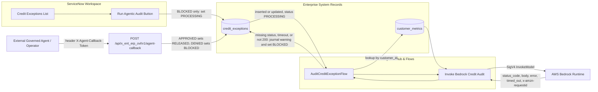
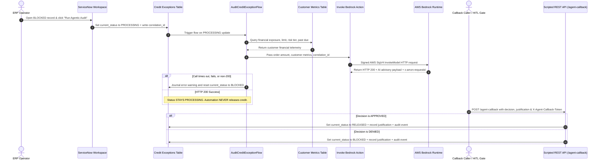

# Agentic ERP Overlay (ServiceNow Fluent + Bedrock)

[](https://0trust.dev)
[](https://0trust.dev#pillar-catalog)
[-81B441?logo=servicenow&logoColor=white)](https://developer.servicenow.com)
[-FF9900?logo=amazon-aws&logoColor=white)](https://aws.amazon.com/bedrock/)
[](#security-invariants)
[-success)](#build--verification)
[](LICENSE)

> **Enterprise System of Action for AI Governance**  
> A production-grade ServiceNow Fluent application (scope `x_ent_erp_ovl`) orchestrating order-to-cash exception workflows with Amazon Bedrock runtime inference, AWS SigV4 request signing, dual audit trails, and strict Human-in-the-Loop (HITL) release gates.

---

## Executive Overview

Enterprise AI agents can read ERP data and analyze exceptions, but **granting AI agents autonomous write-back or release authority creates catastrophic risk of unauthorized financial releases and Confused Deputy attacks**.

This repository implements **Pillar 4 (Enterprise System of Action)** of the **[0trust.dev](https://0trust.dev)** ecosystem. It demonstrates how to pair ServiceNow’s modern TypeScript-based **Fluent SDK** (`@servicenow/sdk`) with **Amazon Bedrock** to create an audited, resilient Human-in-the-Loop exception management overlay across five mission-critical order-to-cash stages:
1. **Credit Holds** (`credit_exceptions`)
2. **Order Holds** (`order_exceptions`)
3. **Fulfillment Holds** (`fulfillment_exceptions`)
4. **Invoice Disputes** (`invoice_exceptions`)
5. **Cash Application** (`cash_exceptions`)

```
   ┌────────────────────────────────────────────────────────────────────────┐
   │                       ServiceNow System of Action                      │
   │  Operator clicks      Background Flow executes       Scripted REST     │
   │  "Run Agentic Audit"  AWS SigV4 Signed Bedrock Call  Release Callback  │
   │        │                         │                           │         │
   │        ▼                         ▼                           ▼         │
   │   [BLOCKED] ──────────────► [PROCESSING] ──────────────► [RELEASED]    │
   │        ▲                         │ (on error/timeout)                  │
   │        └─────────────────────────┘                                     │
   └────────────────────────────────────────────────────────────────────────┘
```

---

## Architecture & Workflows

### Component Architecture



### End-to-End Sequence Diagram



---

## Security Invariants

The architecture enforces four non-negotiable enterprise security invariants:

### 1. Non-Delegation of Authority (Flows Never Release)
- The automated ServiceNow Flow triggers Bedrock strictly for **advisory analysis**.
- The Flow **never** sets a record to `RELEASED`. If the model call fails or times out, status reverts to `BLOCKED`.
- State transition to `RELEASED` can only occur through the Scripted REST callback (`POST /api/x_ent_erp_ovl/v1/agent-callback`), ensuring all approvals require explicit human sign-off or external policy evaluation (e.g. from [`agent-governance`](https://github.com/c2pig/agent-governance)).

### 2. SigV4 Cryptographic Machine Identity
- ServiceNow IntegrationHub script calculates cryptographic **AWS Signature Version 4 (SigV4)** with HMAC-SHA256 headers (`Authorization`, `x-amz-date`, `x-amz-content-sha256`) for every request.
- Proves machine identity to AWS IAM and Amazon Bedrock without sending credentials over third-party proxies.

### 3. Strict Secret Masking & Isolation
- Sensitive credentials (`aws_access_key`, `aws_secret_key`, and `callback_token`) reside in ServiceNow encrypted system properties (`glide.sys_properties` with type `password2way`).
- Passwords and Authorization headers are masked from system logs, audit events, journals, and client scripts.
- Callback token verification uses constant-time string comparison to resist timing attacks.

### 4. Dual Audit Trails & Correlation Join
- **Native ServiceNow Field Audit (`sys_audit`)**: Every stage table, `customer_metrics`, and `x_ent_erp_ovl_audit_events` is defined with `audit: true` to track field deltas natively.
- **Append-Only Immutable Event Trail (`x_ent_erp_ovl_audit_events`)**: Records `BUTTON`, `BEDROCK_RESULT`, and `CALLBACK` events with `correlation_id` and the AWS `x-amzn-requestid` (`aws_request_id`), enabling cross-system join queries between ServiceNow and AWS CloudWatch / S3 Bedrock logs.

---

## Ecosystem Integration

This repository operates within the **[0trust.dev](https://0trust.dev)** Zero Trust AI portfolio:

| Ecosystem Pillar | Repository | How It Connects to This ERP Overlay |
| :--- | :--- | :--- |
| **Pillar 0: Platform IaC** | [`managed-infrastructure`](https://github.com/c2pig/managed-infrastructure) | Provisions AWS IAM roles, STS trust policies, and Bedrock model permissions consumed by this app. |
| **Pillar 1: Agent Identity** | [`cross-cloud-agent-identity`](https://github.com/c2pig/cross-cloud-agent-identity) | Provides cryptographic machine identity and On-Behalf-Of (OBO) token exchange for multi-cloud agents. |
| **Pillar 2: Workforce IAM** | [`iam-demo`](https://github.com/c2pig/iam-demo) | Manages workforce identity lifecycle (SCIM/JML) and JIT privileged access to the ServiceNow Workspace. |
| **Pillar 3: MCP Governance** | [`agent-governance`](https://github.com/c2pig/agent-governance) | Upstream policy interceptor enforcing DLP, RBAC, and HITL thresholds for Bedrock agents calling ERP tools. |
| **Pillar 4: System of Action** | **`now-erp-overlay-app`** *(This repo)* | The enterprise system of record and action executing audited workflows with deterministic HITL release gates. |

---

## Repository Layout

```text
now-erp-overlay-app/
├── now.config.json                 # Application scope (x_ent_erp_ovl) and SDK configuration
├── package.json                    # @servicenow/sdk 4.14.0 & @servicenow/cli 30.2.0 dependencies
├── tsconfig.json                   # TypeScript configuration
├── scripts/
│   └── prepare-fluent-entry.mjs    # Fluent entry preparation pre-build hook
├── src/
│   ├── app.fluent.ts               # ServiceNow Fluent schema (tables, roles, system properties)
│   ├── generated/keys.ts           # Generated Fluent reference keys
│   ├── server/
│   │   ├── api-routes.ts           # Scripted REST API (/agent-callback) with token validation
│   │   ├── spoke-actions.ts        # IntegrationHub SigV4 InvokeModel script action
│   │   └── workflow-flows.ts       # 5 stage workflow flows (credit, order, fulfillment, invoice, cash)
│   └── ui/
│       └── workspace-components.ts # Workspace lists and "Run Agentic Audit" UI action buttons
├── docs/
│   ├── er-diagram.svg              # Entity-Relationship diagram across ERP exception tables
│   └── use-cases.md                # Enterprise use cases and stage flow walkthroughs
└── LESSON_LEARN.md                 # Real-world deployment lessons: scope naming and company code config
```

---

## Build & Verification

### Prerequisites
- Node.js 20+
- npm 10+

### 1-Command Local Compilation (Offline)
This project compiles entirely offline using the `@servicenow/sdk` Fluent compiler (`now-sdk build`), validating all TypeScript definitions, table schemas, flows, and REST endpoints:

```bash
# Install dependencies
npm install

# Run TypeScript type check
npm run typecheck

# Compile ServiceNow Fluent metadata to dist/app
npm run build
```

Platform XML metadata and update sets are generated into `dist/app/` without requiring an active ServiceNow instance connection:
- `dist/app/dictionary/`: Data dictionary definitions for stage exception tables
- `dist/app/scope/`: Application scope metadata
- `dist/app/update/`: Packaged update set XML definitions

### Deployment to ServiceNow Instance (Optional)
When deploying to a live ServiceNow development instance:

```bash
# Deploy to connected instance
npm run deploy
```

> [!TIP]
> **Company Code Scoping**: Custom scopes on personal developer instances require matching company code configurations. Refer to [`LESSON_LEARN.md`](LESSON_LEARN.md) for how `glide.appcreator.company.code` and `sn_appauthor.all_company_keys` configure scope `x_ent_erp_ovl`.

---

## Amazon Bedrock Invocation Logging

To enable full end-to-end auditability across ServiceNow and AWS Bedrock:
1. In the **AWS Bedrock Console**, navigate to **Settings** -> **Model invocation logging**.
2. Select destination (**Amazon CloudWatch Logs** or **Amazon S3**).
3. Include request and response metadata.
4. Cross-reference the `aws_request_id` stored on ServiceNow `x_ent_erp_ovl_audit_events` rows with CloudWatch log search queries (`filter @requestId = "..."`).
