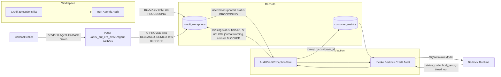

# Agentic ERP Overlay

ServiceNow Fluent application for credit-block overlays. Scope `x_ent_erp_ovl` (the hyphenated form `x-ent-erp-ovl` is not a valid scope). The application source lives in [`sn-erp-overlay-app`](sn-erp-overlay-app).

A workspace user queues an audit. A flow looks up customer metrics and calls the model runtime with a signed request. The flow never releases credit. Release happens only when a caller posts an approved decision to the callback API.

## Architecture



`Run Agentic Audit` is a record button. It is available while `current_status` is `BLOCKED`, and it sets that field to `PROCESSING`, which starts `AuditCreditExceptionFlow`.

The flow looks up `customer_metrics` by `customer_id`, then calls the Integration Hub script step. That step reads the endpoint, access key, secret key, region, and model id from password and string system properties, signs the request with SigV4, and returns `status_code`, `body`, `error`, and `timed_out`. If the status is missing, the call timed out, or the status is not 200, the flow appends a warning to `ai_justification` and sets `current_status` back to `BLOCKED`.

`POST /api/x_ent_erp_ovl/v1/agent-callback` requires header `X-Agent-Callback-Token`, compared in constant time with property `x_ent_erp_ovl.callback_token`. The body is `order_id`, `decision` (`APPROVED` or `DENIED`), and `justification`. `order-id` is accepted when `order_id` is absent. `APPROVED` sets `RELEASED`. `DENIED` sets `BLOCKED`. The justification is appended to `ai_justification`.

## Layout

```text
sn-erp-overlay-app/
├── now.config.json          scope, name, and SDK paths
├── package.json
├── src/app.fluent.ts        tables, role, and system properties
├── src/server/api-routes.ts callback REST API
├── src/server/spoke-actions.ts signed InvokeModel action
├── src/server/workflow-flows.ts AuditCreditExceptionFlow
└── src/ui/workspace-components.ts workspace list and Run Agentic Audit
```

The compiler reads `*.now.ts`. `npm run build` and `npm run typecheck` copy these sources to sibling `*.now.ts` files first. The copies are gitignored.

## Build

From `sn-erp-overlay-app`, with Node.js 20 or newer:

```bash
npm install
npm run typecheck
npm run build
```

`npm run typecheck` and `npm run build` run offline and write platform metadata under `dist/app`. `npm run deploy` (`now-sdk install`), `now-sdk transform` without `--from`, `now-sdk dependencies`, and `now-sdk auth` need a ServiceNow instance. Replace `scopeId` in `now.config.json` if scope `x_ent_erp_ovl` already exists on that instance.
