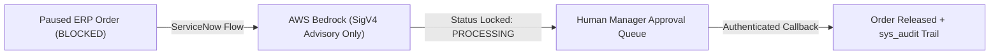

# `now-erp-overlay-app` Local Architecture

> **Global Ecosystem Role:** Powers **Lab 2 (`AI Agent ERP Overlay` — ServiceNow HITL)** on [`0trust.dev`](https://github.com/c2pig/0trust.dev/blob/main/docs/ECOSYSTEM_MAP.md).

- **Related Docs**: [`docs/use-cases.md`](use-cases.md) · [`docs/er-diagram.svg`](er-diagram.svg)
- **Global Architecture**: [`0trust.dev/docs/labs/agentic-transaction.md`](https://github.com/c2pig/0trust.dev/blob/main/docs/labs/agentic-transaction.md)
