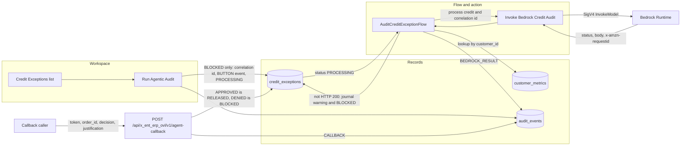
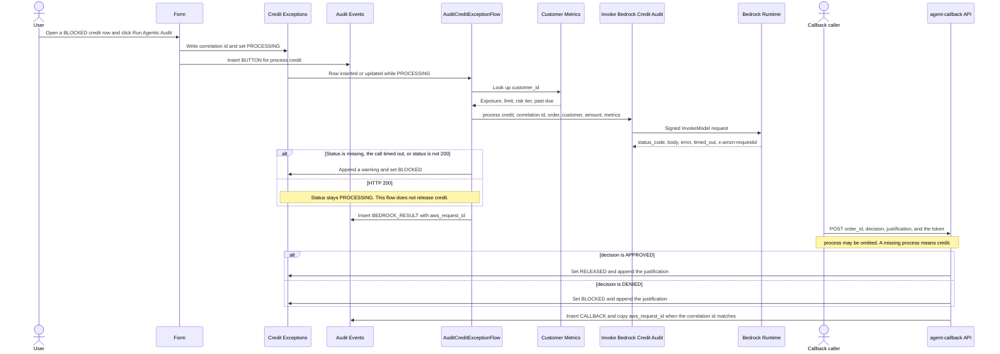
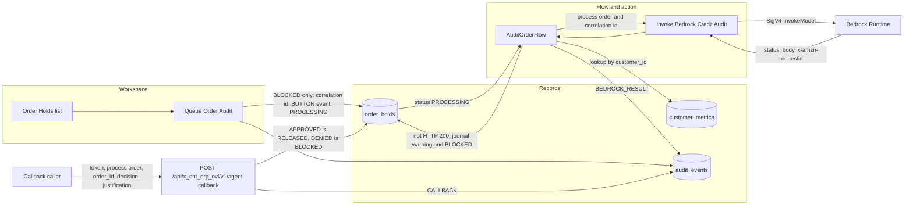
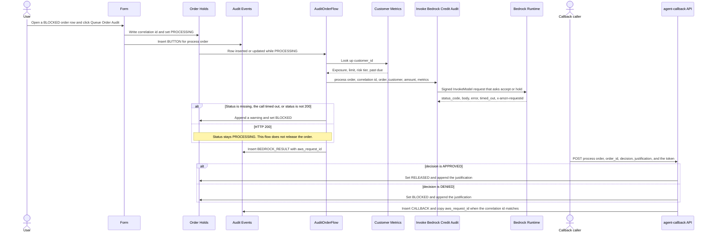
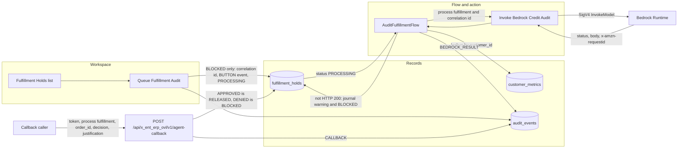
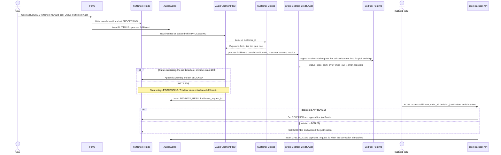
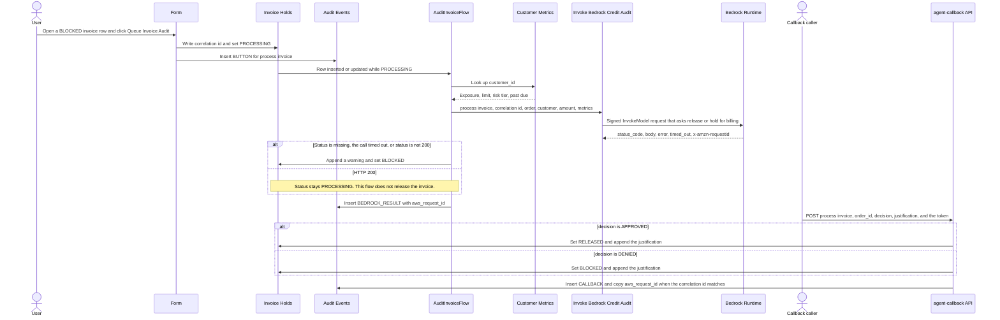
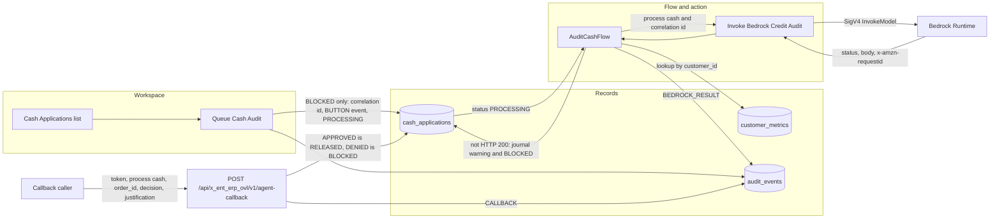
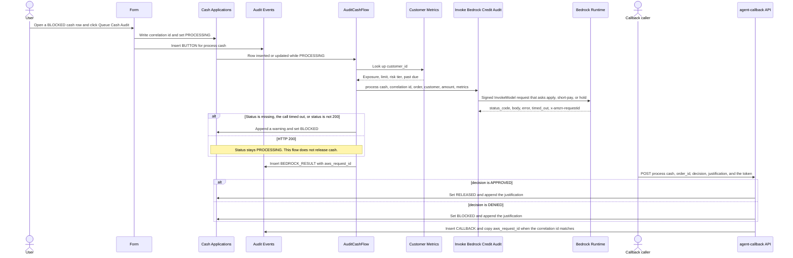

# Order-to-cash use cases

Scope `x_ent_erp_ovl`. One app holds five stages. A person queues the audit from a `BLOCKED` row. The stage flow looks up `x_ent_erp_ovl_customer_metrics` by `customer_id` and calls **Invoke Bedrock Credit Audit**. The model only advises. The flow never sets `RELEASED`.

`POST /api/x_ent_erp_ovl/v1/agent-callback` is the only release. The header `X-Agent-Callback-Token` must match `x_ent_erp_ovl.callback_token`. `APPROVED` sets `RELEASED`. `DENIED` sets `BLOCKED`. A missing `process` means `credit`.

Every stage row stores a correlation id. `x_ent_erp_ovl_audit_events` records `BUTTON`, `BEDROCK_RESULT`, and `CALLBACK`. `BEDROCK_RESULT` stores `x-amzn-requestid` as `aws_request_id`.

## Credit

Accept or hold a credit block. Table `x_ent_erp_ovl_credit_exceptions`. Button **Run Agentic Audit**. Flow `AuditCreditExceptionFlow`. Process `credit`. The prompt asks the model to recommend `APPROVED` or `DENIED`.

### Architecture

### Sequence

## Order

Accept or hold an order. Table `x_ent_erp_ovl_order_holds`. Button **Queue Order Audit**. Flow `AuditOrderFlow`. Process `order`. The prompt asks the model to recommend accept or hold.

### Architecture

### Sequence

## Fulfillment

Release or hold pick and ship. Table `x_ent_erp_ovl_fulfillment_holds`. Button **Queue Fulfillment Audit**. Flow `AuditFulfillmentFlow`. Process `fulfillment`. The prompt asks the model to recommend release or hold for pick and ship.

### Architecture

### Sequence

## Invoice

Release or hold billing. Table `x_ent_erp_ovl_invoice_holds`. Button **Queue Invoice Audit**. Flow `AuditInvoiceFlow`. Process `invoice`. The prompt asks the model to recommend release or hold for billing.

### Architecture

### Sequence

## Cash

Apply, short-pay, or hold a payment. Table `x_ent_erp_ovl_cash_applications`. Button **Queue Cash Audit**. Flow `AuditCashFlow`. Process `cash`. The prompt asks the model to recommend apply, short-pay, or hold.

### Architecture

### Sequence

